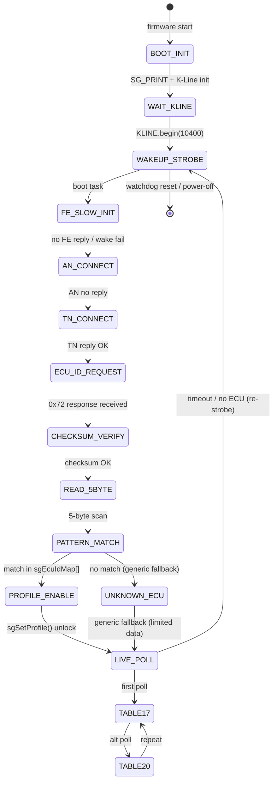

# ARCHITECTURE GRAPH

**Project:** `source_SUN_DIAG_GAUGE_v1_1_1_BETA17_WAVE110I_ECUID_UNLOCK`
**Firmware:** `1.1.1-beta17-wave110i-ecuid-unlock-20260807`
**Target:** `ESP32-2432S028 CYD / ILI9341 320×240 / K-Line ISO9141 (RX GPIO22 / TX GPIO27 / 10400 8N1)`
**Lead Architect:** Hermes (lead-architect) | **Lead QA-Debugger:** Hermes (qa-debugger)

---

## 1. Module & Include Hierarchy Graph

```mermaid
graph TD
  A[entry .ino<br/>source_SUN_DIAG_GAUGE_v1_1_1_BETA17_WAVE110I_ECUID_UNLOCK.ino]
  B[00_SG_Config.h<br/>pins, version, LVGL config]
  C[01_SG_Model.h<br/>SG_Gauge state model]
  D[K-Line Stack]
  E[02_SG_KLine.h<br/>KLINE_RX 22 / TX 27 / 10400 8N1]
  F[22_SG_KLine_SafetyTransport_Core.h<br/>V330 firewall, checksum, session]
  G[Decode Engine]
  H[04_SG_Decode.h<br/>sgDecodeMain_* / sgDecodeAux_* / sgAux* utilities]
  I[Data Structs]
  J[01_SG_Model.h<br/>SG_Gauge / SG_LiveGauge]
  K[Profile & Identity]
  L[03_SG_ProfileDB.h<br/>sgProfiles[]]
  M[19_SG_EcuIdentityDB.h<br/>sgEcuIdentityDb / sgEcuIdMap]
  N[UI Renderers & Assets]
  O[07_SG_UI.h<br/>LVGL 8.3.11 + TFT_eSPI 2.5.43]
  P[assets/<br/>07B / 07C / 07D]
  Q[07A_SG_BootAnimation.h]
  R[08_SG_Monitor.h<br/>Serial + Bluetooth Monitor]

  A --> B
  A --> C
  A --> D
  B --> H
  C --> I
  E --> F
  D --> G
  F --> G
  G --> J
  G --> K
  G --> N
  K --> M
  H --> O
  O --> P
  O --> Q
  O --> R
  C --> L
  C --> M
  E --> L
  F --> L
  P --> O
  Q --> O
  R --> O
  G --> N
  N --> O
```

**Node map:**
- `A` = entry `.ino`
- `B` = config + pins + version (`00_SG_Config.h`)
- `C` = core model (`01_SG_Model.h`)
- `D–F` = K-Line protocol stack (hardware + safety firewall)
- `G` = decode engine (`04_SG_Decode.h`)
- `I–J` = data structures + gauge model
- `K–M` = ECU identity & profile DB
- `N–P` = UI renderer + assets (LVGL / TFT_eSPI / 3 asset headers)
- `Q` = boot animation
- `R` = USB / Bluetooth monitor

---

## 2. K-Line ECU ID Unlock State Machine



**State map:**
- `BOOT_INIT` → `WAIT_KLINE` → `WAKEUP_STROBE`
- `FE_SLOW_INIT` (70ms LOW / 130ms HIGH) → `AN_CONNECT` → `TN_CONNECT`
- `ECU_ID_REQUEST` → `CHECKSUM_VERIFY` → `READ_5BYTE` → `PATTERN_MATCH`
- `PROFILE_ENABLE` → `LIVE_POLL` (Table17 ↔ Table20 alternating)
- `UNKNOWN_ECU` → generic fallback; `WAKEUP_STROBE` on timeout

---

## 3. Dataflow & UI Render Pipeline

```mermaid
flowchart LR
  A[K-Line RX GPIO22<br/>K-Line TX GPIO27]
  B[KLine Core<br/>02_SG_KLine.h + 22_SG_KLine_SafetyTransport_Core.h]
  C[Decode Engine<br/>04_SG_Decode.h]
  D[Data Structures<br/>01_SG_Model.h SG_Gauge / SG_LiveGauge]
  E[ECU Identity & Profile<br/>03_SG_ProfileDB.h + 19_SG_EcuIdentityDB.h]
  F[LVGL 8.3.11 + TFT_eSPI 2.5.43]
  G[ILI9341 320×240 CYD<br/>tft.init() / setRotation(1)]
  H[Assets<br/>07B / 07C / 07D]
  I[Display Render<br/>SG_UX / language / backlight]

  A --> B
  B --> C
  C --> D
  D --> E
  E --> F
  F --> G
  G --> H
  F --> I
  H --> I
  B --> E
```

---

## 4. Documentation Wiki Links (Obsidian Graph View)

### Related Documentation
- [[HARDWARE_BASELINE]] — Hardware target: ESP32-2432S028 CYD, ILI9341 320×240, K-Line RX 22/TX 27, 10400 8N1
- [[KNOWN_GOOD_BUILD]] — Baseline-001: Flash 1,801,287 B (57%) / RAM 59,064 B (18%) / Exit 0
- [[TEST_GATE]] — Pre-bench checklist (A–G: power-up, K-Line init, wakeup, ECU ID unlock, live-data polling, safety/timeouts)
- [[PROJECT_SUMMARY]] — ESP32 Smart Gauge for Honda ECU K-Line overview
- [[RELEASE_MANIFEST]] — Draft release `1.1.1-beta17-wave110i-ecuid-unlock-20260807`

### Progression: Step Reports
- [[STEP1_ANALYSIS_REPORT]] → [[STEP2_EXECUTION_REPORT]] → [[STEP3_EXECUTION_REPORT]] → [[STEP4_EXECUTION_REPORT]] → [[STEP5_BENCH_READINESS_REPORT]] → [[STEP6_BENCH_FLASH_REPORT]] → [[STEP7_WORKSPACE_CLEANUP_REPORT]]
- [[STEP8_CODE_UI_AUDIT_REPORT]], [[STEP9_CODE_DOCS_AND_FIXES_REPORT]], [[STEP10_FLASH_VERIFICATION_REPORT]], [[STEP11_STABLE_V1_RELEASE_REPORT]], [[STEP12_ENTRY_FILE_ALIGNMENT_REPORT]], [[STEP13_BETA_INIT_AND_SNAPSHOT_REPORT]], [[STEP14_README_GENERATION_REPORT]]
- Stable v1.0.0 reports: `docs/reports/stable/` (legacy & v1.0.0-stable execution reports)
- Beta reports: `docs/reports/beta/` (active beta feature reports: BETA_STEP1..4 and future beta steps)

---

## 5. Module Quick Index

| File | Role |
|---|---|
| `00_SG_Config.h` | Pins, version, LVGL config (`SG_FIRMWARE_VERSION`) |
| `01_SG_Model.h` | SG_Gauge / SG_LiveGauge state model |
| `02_SG_KLine.h` | K-Line init, wakeup (FE/AN/TN) |
| `03_SG_ProfileDB.h` | `sgProfiles[]` registry |
| `04_SG_Decode.h` | Decode engine (`sgDecodeMain_* / sgDecodeAux_*`) |
| `05_SG_DTC.h` | DTC add/clear/report |
| `06_SG_Engine.h` | Engine data, live-data priority |
| `07_SG_UI.h` | LVGL 8.3.11 + TFT_eSPI 2.5.43 (320×240) |
| `07A_SG_BootAnimation.h` | Non-blocking boot animation |
| `08_SG_Monitor.h` | Serial + Bluetooth monitor (115200) |
| `09_SG_Input.h` | Single-button standard (TAP/HOLD) |
| `10_SG_OTA.h` | OTA mode (AP) |
| `11_SG_Backlight.h` | PWM backlight task |
| `12_SG_NVStorage.h` | NVS settings |
| `13_SG_Timings.h` | Display timings |
| `15_SG_Watchdog.h` | Watchdog |
| `16_SG_Language.h` | Language strings |
| `17_SG_BootSlot.h` | Boot slot lock |
| `18_SG_AppLive.h` | App Live JSON (stft/ltft/stft_ok/ltft_ok) |
| `19_SG_EcuIdentityDB.h` | ECU identity DB (`sgEcuIdentityDb`) |
| `20_SG_ConfirmedDisplayDB.h` | Confirmed display identity |
| `21_SG_FontThai14.cpp` | Thai font |
| `22_SG_KLine_SafetyTransport_Core.h` | V330 safety firewall, checksum, session |
| `23_SG_DTC_Database.h` | DTC database + lookup |
| `24_SG_AlexMapX_LiveData_Beta.h` | Live-data decode (AlexMapX) |
| `25_SG_SmartHealth.h` | Smart health, warnings |
| `26_SG_UX_Adjustments.h` | UX adjustments (language, hold text) |
| `27_SG_ScreenCapture.h` | Screen capture task |
| `assets/` | `07B`, `07C`, `07D` (racing page + bluetooth icon) |
